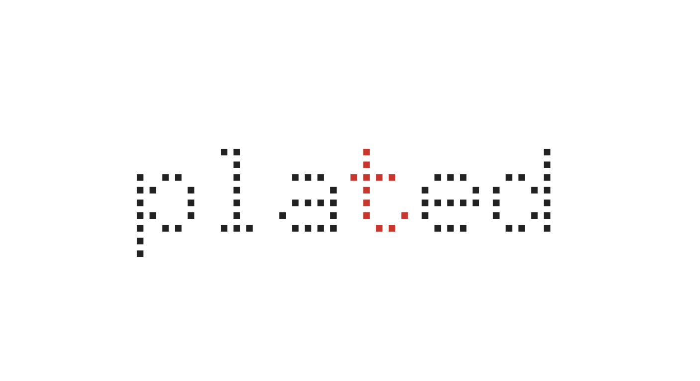

<!-- LOGO AND SHIELDS -->

      
    
    
    
    
    
    
      
    <h1>Plated.</h1>
    
<i>An open source management platform for Roblox Restaurant Groups.</i>

     
    

        <a href="https://github.com/TeamPlated/plated/"><strong>Explore the docs »</strong></a>
         
         
        <a href="https://plated.thehenry.dev">Website</a>
        &middot;
        <a href="https://docs.plated.thehenry.dev">Documentation</a>
        &middot;
        <a href="https://github.com/TeamPlated/plated/blob/main/CHANGELOG.md">Changelog</a>
        &middot;
        <a href="https://github.com/TeamPlated/plated/issues/new?labels=bug&template=01-bug-report.md">Report a Bug</a>
        &middot;
        <a href="https://github.com/TeamPlated/plated/issues/new?labels=bug&template=02-feature-request.md">Request a Feature</a>
        &middot;
        <a href="https://discord.gg/dEv3QCaa2R">Discord Server</a>
    

> [!IMPORTANT]
> Plated is not ready to be released yet, please wait while we get everything ready for you. We will announce our release in our Discord Server, you are free to join it.

<!-- TABLE OF CONTENTS -->

    
Table of Contents

    <ol>
        <li>
            <a href="#about-the-project">About The Project</a>
            <ul>
                <li><a href="#features">Features</a></li>
                <li><a href="#built-with">Built With</a></li>
            </ul>
        </li>
        <li>
            <a href="#getting-started">Getting Started</a>
            <ul>
                <li><a href="#plated-cloud-hosted">Plated Cloud Deployment</a></li>
                <li><a href="#deploy-with-vercel">Vercel Deployment</a></li>
                <li><a href="#self-hosting">Self-Hosting</a></li>
            </ul>
        </li>
        <li><a href="#usage">Usage</a></li>
        <li><a href="#roadmap">Roadmap</a></li>
        <li><a href="#contributing">Contributing</a></li>
        <li><a href="#license">License</a></li>
        <li><a href="#contact">Contact</a></li>
        <li><a href="#acknowledgements">Acknowledgements</a></li>
    </ol>

<!-- ABOUT THE PROJECT -->
<h2 id="about-the-project">About The Project</h2>

There are many different utilities for Roblox Groups, however there aren't enough that cater specifically to Ro-Restaurants, so we have made <b>Plated</b>, a group management platform for Ro-Restaurants, so you can organise everything properly.

<h3 id="features">Features</h3>

Plated features many tools for your group, including the following.

<ul>
    <li>Session Hosting</li>
    <li>Automated Announcements</li>
    <li>Extensive Operational Stats</li>
    <li>Automated Promotion</li>
    <li>Activity Tracking</li>
    <li>Live Analytics</li>
    <li>Training, Application & Ranking Centres</li>
    <li>Employee Logbook</li>
    <li>Leave of Absence Notifications</li>
    <li>Group Documents & Policies</li>
    <li>Integrations</li>
    <li>and much more!</li>
</ul>

<h3 id="built-with">Built With</h3>

Plated is built on many frameworks, including...

<ul>
    <li></li>
    <li></li>
    <li></li>
    <li></li>
</ul>

<!-- GETTING STARTED -->
<h2 id="getting-started">Getting Started</h2>

Thank you for choosing to use Plated! We really appreciate it. To host Plated, we have a few methods. You can self-host Plated, Deploy with Vercel, or deploy with Plated Cloud, our own hosting platform.

<h3 id="plated-cloud-hosted">Plated Cloud Deployment</h3>

Plated Cloud Deployment is our own cloud hosting server, designed specifically for Plated. The platform is free for everyone, making it the recommended way to host plated.

<h3 id="deploy-with-vercel">Deploy with Vercel</h3>

Deploying with Vercel is a free method for hosting yourself, without needing to purchase infrastructure. You can host with Vercel using the link below.
 

<h3 id="self-hosting">Self Hosting</h3>

Self-Hosting is the most unrestricted way to host Plated, with total control over how you host Plated, however it is the most difficult to set up. To set up Plated locally, please follow our documentation at <a href="https://docs.plated/thehenry.dev">docs.plated.thehenry.dev</a>.

<!-- USAGE EXAMPLES -->
<h2 id="usage">Usage</h2>

Plated is used for Roblox Restaurants that want to step up their game. Some of our featured groups include...

<ul>
    <li>No one. Sign up to be a featured group on our website!</li>
</ul>

<!-- ROADMAP -->
<h2 id="roadmap">Roadmap</h2>

You can view our public roadmap for Plated at <a href="https://feedback.plated.thehenry.dev">feedback.plated.thehenry.dev</a>. It contains our roadmap, and also feature requests from our GitHub issues.

<!-- CONTRIBUTING -->
<h2 id="contributing">Contributing</h2>

To learn more about Contributing for Plated, please read CONTRIBUTING.md to find out about making the Plated community better.
  

<b>Top Contributors:</b>

<!-- LICENSE -->
<h2 id="license">License</h2>

This project is licensed under the MIT License. See LICENSE.txt for more information.

<!-- CONTACT -->
<h2 id="contact">Contact</h2>

To contact the maintainers, join our Discord Server or email <a href="mailto:henry@thehenry.dev">henry@thehenry.dev</a>.

<!-- ACKNOWLEDGEMENTS -->
<h2 id="acknowledgements">Acknowledgements</h2>

Credits to the following websites.

<ul>
    <li>Choose an Open Source License</li>
    <li>Shields.io Badges</li>
</ul>

<i>Made with ❤️ by TeamPlated and Contributors.</i>
